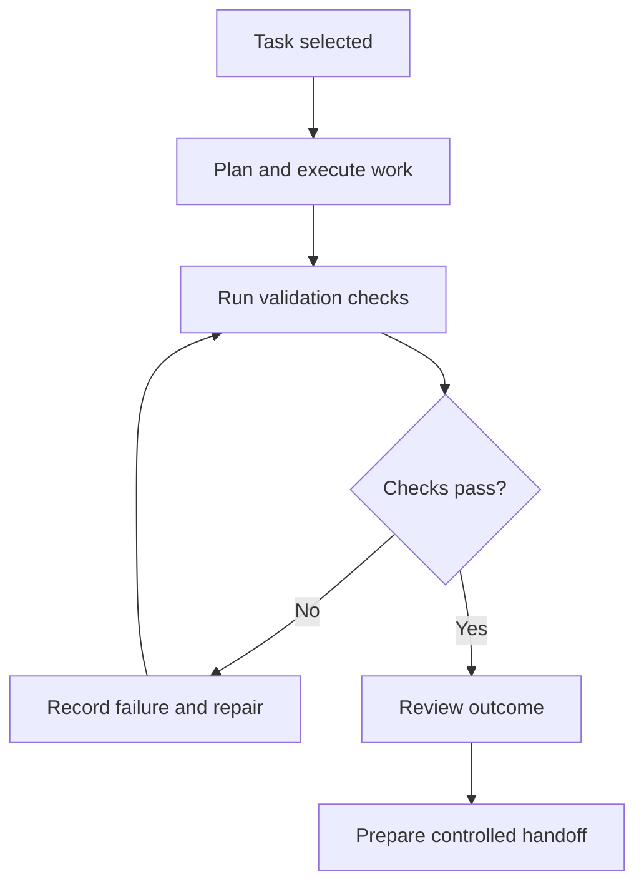

# OrchestrationOps — Project Showcase

**Domain:** Development automation and software engineering workflows  
**Role:** Designer & Developer  
**Repository type:** Public portfolio documentation; **private implementation is not published**  
**Status:** Ongoing personal engineering project

## The problem

Multiple development projects generate implementation tasks, code changes, test results, and review work. Tracking whether each step was actually completed can be difficult, especially across workstations and tools.

OrchestrationOps explores a **local-first Python control layer** for organizing development work, applying validation, retaining checkpoints, and keeping outcomes visible.

## Engineering concepts demonstrated

- Organizing automation logic as a Python package with maintainable modules.
- Describing task lifecycles and explicit execution states.
- Treating testing, linting, type checking, and builds as important validation stages.
- Tracking checkpoint and review results before subsequent actions.
- Documenting operations and repeatable recovery procedures.

## Public, simplified workflow

This diagram is original portfolio documentation, not a verbatim copy of private implementation details.

See [architecture notes](docs/architecture.md) and [testing principles](docs/testing-principles.md).

## Source availability

The core code, deployment information, infrastructure details, credentials, and private task histories are not published. For directly inspectable Python code and tests, see [TaskFlow SQL API](https://github.com/opsarmour0-007/taskflow-sql-api).
